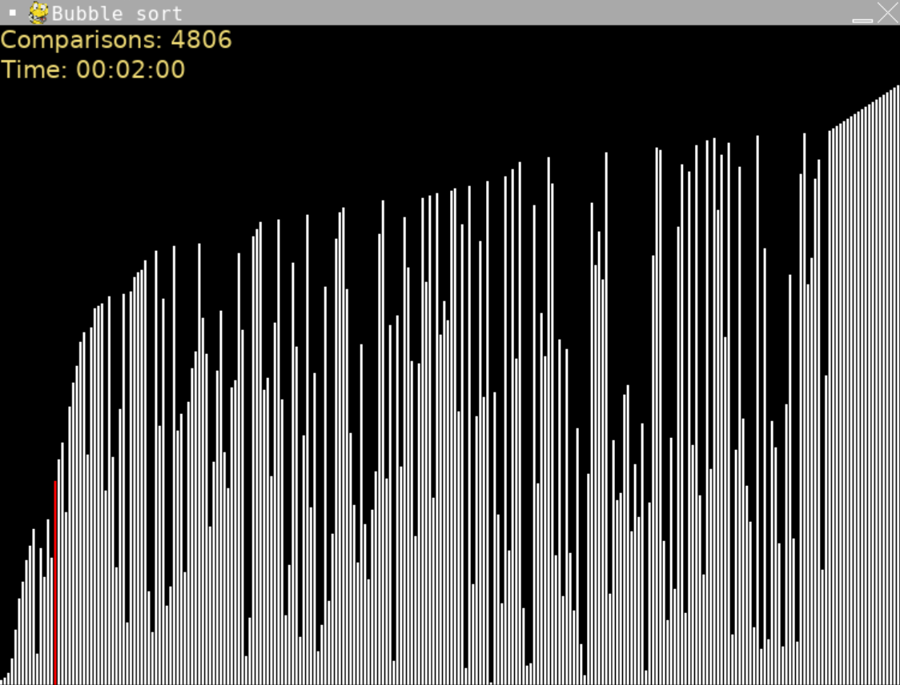

# Bubble Sort Visualization

- Language: Python (pygame)
- Completion date: January 2023

An animated bubble sort visualization over a shuffled list of values from 1 to 250. Each value is drawn as a vertical bar; adjacent values are compared and swapped when they are out of order.

The display highlights a value involved in the current comparison, counts comparisons, and shows elapsed time. After each pass, the comparison range shrinks as the largest remaining value reaches its sorted position. Once the list is sorted, the bars turn green.

## Usage

Sorting starts automatically. There are no interactive sorting controls. The legacy display loop does not process window-close events; use Ctrl+C in the launching terminal to stop it.

## Run

From the repository root:

```sh
python3.11 -m pip install pygame
python3.11 Bubble-sort-visualization/main.py
```

Inside this project folder, use `python3.11 main.py` instead.

## Screenshot



Original portfolio screenshot, recovered from `sort.png` on the portfolio site.

[Original portfolio entry](https://ericwang-digital-portfolio.pages.dev/computer_science.html#Bubble%20sort%20visualizer) · [Archive overview](../README.md)
