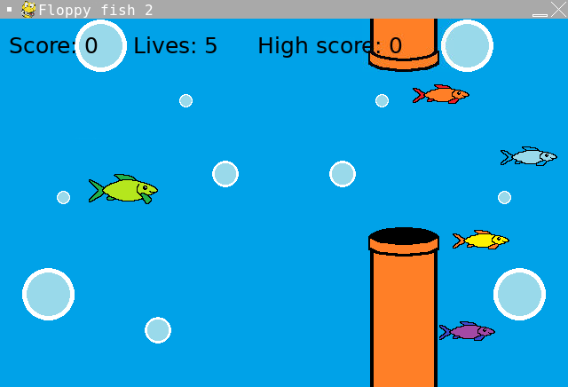

# Floppy Fish 2

- Language: Python (pygame)
- Completion date: March 2023

A sequel to Floppy Fish that replaces direct up/down movement with space-bar jumps. The fish rises during a jump and falls between jumps, while randomized pipe gaps scroll across the screen.

The life counter starts at five. Cleared pipe sets add one point, and collisions reduce the life counter without subtracting points. Every ten points increases the scrolling speed and changes the visual theme, including alternate fish sprites for jumping and falling. The high score lasts for the current session.

## Controls

- Click or press a key on the welcome screen to start.
- **Space**: jump.
- Click or press a key on the game-over screen to restart.

## Run

From the repository root:

```sh
python3.11 -m pip install pygame
python3.11 Floppy-fish-2/main.py
```

Inside this project folder, use `python3.11 main.py` instead. Keep `images/` and `sounds/` alongside the source; they contain the game's artwork and audio.

## Screenshot



[Original portfolio entry](https://ericwang-digital-portfolio.pages.dev/computer_science.html#Floppy%20fish%202) · [Archive overview](../README.md)
