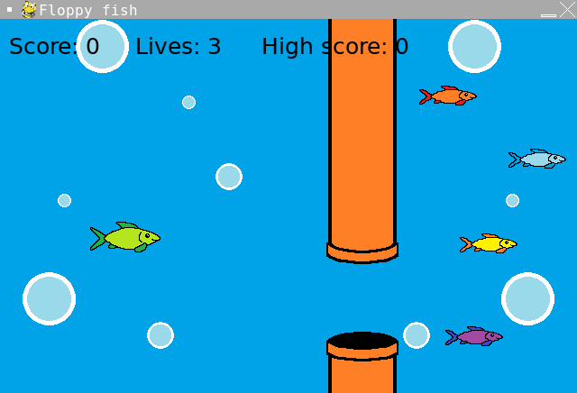

# Floppy Fish

- Language: Python (pygame)
- Completion date: June 2022

A side-scrolling game where you move a fish up and down to pass through gaps between scrolling pipes. Pipe heights are randomized, and cleared pipe sets add one point. The life counter starts at three; collisions reduce it rather than subtracting points.

Every ten points, the scrolling speed increases and the game advances through different fish, pipe, and background artwork. A high score is tracked during the current session.

## Controls

- Click or press a key on the welcome screen to start.
- **W** or **Up Arrow**: move up.
- **S** or **Down Arrow**: move down.
- Click or press a key on the game-over screen to restart.

## Run

From the repository root:

```sh
python3.11 -m pip install pygame
python3.11 Floppy-fish/main.py
```

Inside this project folder, use `python3.11 main.py` instead. Keep `images/` and `sounds/` alongside the source; they contain the game's artwork and audio.

## Screenshot



[Original portfolio entry](https://ericwang-digital-portfolio.pages.dev/computer_science.html#Floppy%20fish) · [Archive overview](../README.md)
