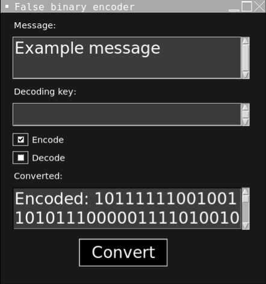

# Legacy Projects

An archive of early Python projects built on Replit: small games, algorithm visualizations, and a desktop encoding utility. These are old learning projects, preserved for reference rather than active development.

Each project has its own folder, README, source, and relevant screenshots. Required game artwork and audio stay with the programs that use them; the digital portfolio website itself is not included.

## Projects

Completion dates are reproduced from the [original computer science portfolio](https://ericwang-digital-portfolio.pages.dev/computer_science.html), not inferred from Git commits or file modification times.

| Project | Completed | Description |
| --- | --- | --- |
| [Single Player Neo Pong](Single-Player-Neo-Pong/README.md) | February 2022 | Pong against a ball-tracking bot, with increasing ball speed and a ten-point match. |
| [Water Drop Catcher](Water-drop-catcher/README.md) | April 2022 | Catch falling droplets with a cup; golden drops are worth five points. |
| [Floppy Fish](Floppy-fish/README.md) | June 2022 | Steer a fish through pipe gaps, with a life counter and changing visual themes. |
| [False Binary Encoder](False-Binary-encoder-with-user-interface/README.md) | September 2022 | A Tkinter message encoder/decoder using ASCII offsets and bit transformations. |
| [Neo Pong](Neo-Pong/README.md) | December 2022 | Local two-player Pong with paddle controls, scoring, and sound effects. |
| [Bubble Sort Visualization](Bubble-sort-visualization/README.md) | January 2023 | Animated adjacent comparisons and swaps, with elapsed time and comparison count. |
| [Maze Solver — DFS](maze-solver-dfs/README.md) | February 2023 | Depth-first exploration with backtracking and a final solution-path redraw. |
| [Floppy Fish 2](Floppy-fish-2/README.md) | March 2023 | A jump-controlled sequel with falling motion, five starting lives, and themed sprites. |
| [Maze Solver — BFS](maze-solver-bfs/README.md) | May 2023 | A breadth-first-style maze exploration visualization with multiple active branches. |

## Run locally

The examples use Python 3.11. Install Pygame with the same interpreter you use to run the games and visualizations. From the repository root:

```sh
python3.11 -m pip install pygame
python3.11 Floppy-fish/main.py
```

Replace the project path with any other project's `main.py`; each project README provides its exact command and controls. The Pygame programs resolve their assets relative to their script directories, so keep the supplied artwork and sound files in place.

The False Binary Encoder uses Tkinter instead of Pygame and requires Python 3.11 or newer. Tkinter support depends on the Python installation; check it with `python3.11 -m tkinter`.

```sh
python3.11 False-Binary-encoder-with-user-interface/main.py
```

If `python3` already selects Python 3.11, it can replace `python3.11` in these commands. These are archived programs, not a maintained or extensively modernized application suite.

## Screenshots

These are the original portfolio images, stored inside the relevant project folders. Both Pong entries used the same screenshot in the portfolio; that shared historical image is retained here too.

### Single Player Neo Pong


### Water Drop Catcher


### Floppy Fish


### False Binary Encoder



### Neo Pong


### Bubble Sort Visualization


### Maze Solver — DFS


### Floppy Fish 2


### Maze Solver — BFS


