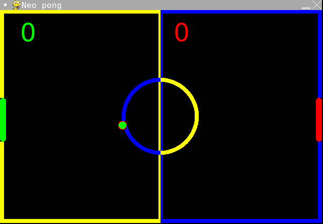

# Single Player Neo Pong

- Language: Python (pygame)
- Completion date: February 2022

A solo Pong game where you control the right paddle and a bot moves the left paddle toward the ball. The bot tracks the ball vertically while it is within tracking range, with a randomized speed offset affecting its movement.

The ball speeds up after paddle hits, missed returns award points, and the first side to ten points wins. The game uses the same artwork and sound effects as the two-player version, with its own copies included in this folder.

## Controls

- Click or press a key on the welcome screen to start.
- **W** or **Up Arrow**: move your paddle up.
- **S** or **Down Arrow**: move your paddle down.
- Click or press a key on the game-over screen to restart.

## Run

From the repository root:

```sh
python3.11 -m pip install pygame
python3.11 Single-Player-Neo-Pong/main.py
```

Inside this project folder, use `python3.11 main.py` instead. Keep the included `images/` and `sounds/` alongside the source.

## Screenshot



The original portfolio used the same `pong.png` for both Pong entries. This is that historical image, not a newly captured single-player screenshot. The completion date above is also reproduced as recorded in the portfolio.

[Original portfolio entry](https://ericwang-digital-portfolio.pages.dev/computer_science.html#Single%20player%20neo%20pong) · [Archive overview](../README.md)
