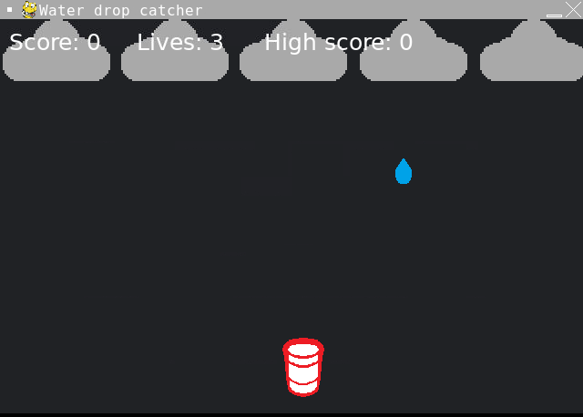

# Water Drop Catcher

- Language: Python (pygame)
- Completion date: April 2022

An arcade game where you move a cup beneath falling water droplets. Standard drops add one point; golden drops add five. Missing a drop reduces the life counter, which starts at three.

Drops fall faster every ten points. Clouds move across the top of the screen, catching and missing drops trigger sound effects, and a high score is tracked for the current session. The plain background is drawn in code; the cloud, cup, and droplet images remain necessary game assets.

## Controls

- Click or press a key on the welcome screen to start.
- **A** or **Left Arrow**: move left.
- **D** or **Right Arrow**: move right.
- Click or press a key on the game-over screen to restart.

## Run

From the repository root:

```sh
python3.11 -m pip install pygame
python3.11 Water-drop-catcher/main.py
```

Inside this project folder, use `python3.11 main.py` instead. Keep the included `images/` and `sounds/` alongside the source.

## Screenshot



[Original portfolio entry](https://ericwang-digital-portfolio.pages.dev/computer_science.html#Water%20drop%20catcher) · [Archive overview](../README.md)
