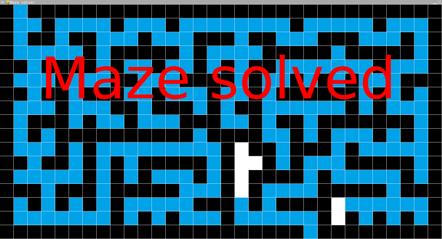

# Maze Solver (BFS)

- Language: Python (pygame)
- Completion date: May 2023

The second maze visualization, originally titled Maze Solver 2. It explores multiple active branches using a list of positions and a record of visited cells, showing the search progress until a branch reaches the exit.

The portfolio describes this as breadth-first search. The archived implementation is a custom breadth-first-style explorer rather than a conventional FIFO-queue BFS; it does not reconstruct a shortest-path solution at the end. Its final view retains the explored cells and displays **Maze solved**.

## Usage

The search starts automatically. The `maze` list in `main.py` defines the map: `#` is a wall, `!` is the start, `*` is the exit, and spaces are open cells. Each cell is drawn on a 60-pixel grid in a 1920×1080 window.

The background is drawn white in code; `wall.png` and `trail.png` are the remaining rendering assets. After completion, close the window or press a key/click to exit.

## Run

From the repository root:

```sh
python3.11 -m pip install pygame
python3.11 maze-solver-bfs/main.py
```

Inside this project folder, use `python3.11 main.py` instead.

## Screenshot



[Original portfolio entry](https://ericwang-digital-portfolio.pages.dev/computer_science.html#Maze%20solver%202) · [Archive overview](../README.md)
