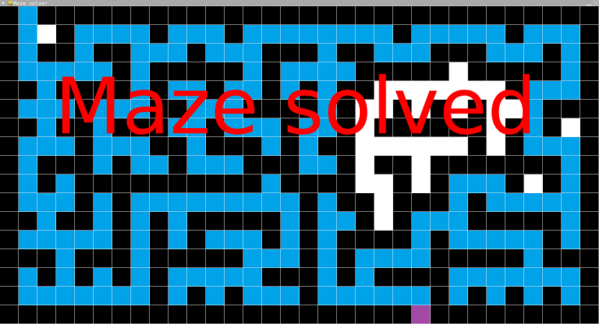

# Maze Solver (DFS)

- Language: Python (pygame)
- Completion date: February 2023

A depth-first maze visualization, originally titled Maze Solver. It follows available passages, records visited cells and decision points, and backtracks when a branch has no unvisited continuation.

Moves are recorded in branch-specific lists. When the exit is reached, the remaining move lists are combined into the solution route, and the maze is redrawn with that path. The archived completion loop repeats the redraw after a five-second pause.

## Usage

The search starts automatically. The `maze` list in `main.py` defines the map: `#` is a wall, `!` is the start, `*` is the exit, and spaces are open cells. Each cell is drawn on a 60-pixel grid in a 1920×1080 window.

The background is drawn white in code; `wall.png`, `trail.png`, and `path.png` render the walls and traversal markers. After completion, close the window or press a key/click to exit; the five-second pause can delay the response.

## Run

From the repository root:

```sh
python3.11 -m pip install pygame
python3.11 maze-solver-dfs/main.py
```

Inside this project folder, use `python3.11 main.py` instead.

## Screenshot



[Original portfolio entry](https://ericwang-digital-portfolio.pages.dev/computer_science.html#Maze%20solver) · [Archive overview](../README.md)
